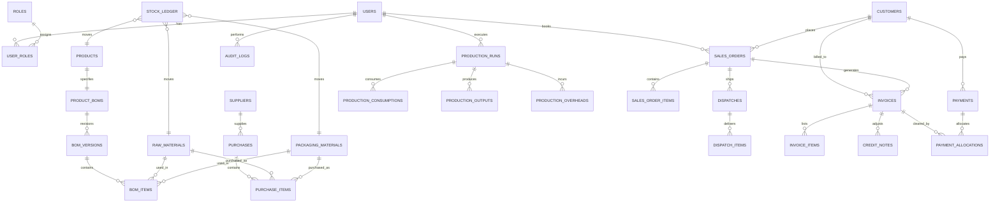

# FOODFLOW ERP: TECHNICAL DESIGN NOTE
### Architectural Design, Data Models, Inventory Valuation & Business Logic
**Organization:** Centre for Digital Infrastructure, National Institute of Technology Tiruchirappalli  
**Document Version:** 1.0.0  

---

## 1. High-Level Architectural Overview

FoodFlow ERP is architected around the **Transactional Ledger Pattern** and **Domain Service Layer Architecture**. The application separates HTTP request handling (Flask Blueprints), core business rules (Domain Services), persistence and validation (SQLAlchemy ORM), and client-side presentation (Jinja2 Templates & Bootstrap 5).

### Core Architectural Layers

```
┌─────────────────────────────────────────────────────────────┐
│                       Client Layer                          │
│   Desktop Web Browser / Responsive Mobile Field Sales UI     │
└──────────────────────────────┬──────────────────────────────┘
                               │ HTTP / HTTPS (CSRF Protected)
┌──────────────────────────────▼──────────────────────────────┐
│                    Route & Auth Layer                       │
│  Flask Blueprints • Flask-Login • Role-Based RBAC Wrappers  │
└──────────────────────────────┬──────────────────────────────┘
                               │ Method Invocations
┌──────────────────────────────▼──────────────────────────────┐
│                   Domain Service Layer                      │
│   StockService   •   ProductionService   •   OrderService   │
│   InvoiceService •   DispatchService     •   PaymentService │
│   ReportService  (Atomic Transactions & Pessimistic Locks)  │
└──────────────────────────────┬──────────────────────────────┘
                               │ SQLAlchemy ORM Models
┌──────────────────────────────▼──────────────────────────────┐
│                   Data Persistence Layer                    │
│      PostgreSQL 16 Relational Engine • Alembic Migrations    │
│  (ACID Transactions, Foreign Key Constraints, Unique Indices)│
└─────────────────────────────────────────────────────────────┘
```

---

## 2. Entity-Relationship Model (ER Diagram)

The database schema connects master data, bill of materials, inventory transactions, production batches, sales orders, billing, and accounting collections:



---

## 3. Stock Ledger Architecture (Immutable Double-Entry Style)

### Design Philosophy
In food manufacturing, overwriting stock balances directly on product records leads to race conditions, untraceable variances, and accounting reconciliation failure. FoodFlow ERP uses an **append-only, immutable transaction log** in the `stock_ledger` table.

```sql
CREATE TABLE stock_ledger (
    id SERIAL PRIMARY KEY,
    item_type VARCHAR(30) NOT NULL,       -- 'raw_material', 'packaging_material', 'finished_good'
    item_id INTEGER NOT NULL,
    movement_date DATE NOT NULL,
    movement_type VARCHAR(50) NOT NULL,   -- 'purchase', 'production_consumption', 'production_output', 'sales_dispatch', 'stock_adjustment'
    direction VARCHAR(5) NOT NULL,        -- 'IN' or 'OUT'
    quantity NUMERIC(12, 3) NOT NULL,
    unit VARCHAR(20) NOT NULL,
    unit_rate NUMERIC(12, 4) DEFAULT 0,
    source_document_type VARCHAR(50),     -- 'Purchase', 'ProductionRun', 'Dispatch', 'StockAdjustment'
    source_document_id INTEGER,
    remarks TEXT,
    created_by_id INTEGER REFERENCES users(id),
    created_at TIMESTAMP DEFAULT CURRENT_TIMESTAMP
);
```

### Stock Balance Derivation
Current stock for any item is dynamically computed by evaluating directional quantities:
$$\text{Current Stock} = \sum_{i \in \text{IN}} \text{quantity}_i - \sum_{j \in \text{OUT}} \text{quantity}_j$$

### Concurrency & Negative Stock Prevention
When recording outward stock movements (production consumption, goods dispatch, or downward adjustments), `StockService` executes a pessimistic row lock (`with_for_update()`) on the master entity:
```python
# Acquire row lock before checking balance
item = RawMaterial.query.with_for_update().get(item_id)
current_balance = StockService.get_stock_balance('raw_material', item_id)
if current_balance < quantity_to_deduct:
    raise InsufficientStockException(
        f"Insufficient stock for {item.name}: available {current_balance}, required {quantity_to_deduct}"
    )
```
This guarantees that concurrent production runs or dispatches can never drive inventory balances negative.

---

## 4. Recipe (BOM) & Production Variance Calculations

### Bill of Materials Versioning
Recipes change due to seasonal ingredient quality, packaging updates, or spice blend reformulations. FoodFlow ERP decouples products from fixed recipes:
- `ProductBOM`: Root link to the product.
- `BOMVersion`: Concrete revision (e.g. `v1`, `v2`) with an `expected_output` (standard batch yield) and active flag.
- `BOMItem`: Material components with `standard_quantity` and `unit`.

### Batch Scaling Formula
When a production supervisor enters a batch multiplier ($M$), planned material requirements scale linearly:
$$\text{Planned Requirement} = \text{Standard Quantity} \times M$$
$$\text{Planned Output} = \text{Standard Expected Output} \times M$$

### Yield Variance & Alert Thresholds
Production efficiency is tracked by comparing actual good packaged output against planned output:
$$\text{Yield Variance \%} = \left(\frac{\text{Actual Output} - \text{Planned Output}}{\text{Planned Output}}\right) \times 100$$

*Benchmark Example:*
- Planned Output: $200.00\text{ packets}$
- Actual Output: $188.00\text{ packets}$
$$\text{Yield Variance \%} = \frac{188 - 200}{200} \times 100 = -6.00\%$$
Because $|-6.00\%| > 3.00\%$ (default tolerance threshold), the system automatically flags `yield_variance_alert = True` and alerts the factory manager.

### Consumption Variance
$$\text{Consumption Variance \%} = \left(\frac{\text{Actual Quantity} - \text{Planned Quantity}}{\text{Planned Quantity}}\right) \times 100$$

*Benchmark Example (Oil):*
- Planned Consumption: $10.000\text{ L}$
- Actual Consumption: $10.500\text{ L}$
$$\text{Consumption Variance \%} = \frac{10.5 - 10.0}{10.0} \times 100 = +5.00\%$$
Because $+5.00\% > 3.00\%$, `variance_alert = True` is triggered on the oil consumption line item.

---

## 5. Costing & Valuation Methodology

### 1. Moving Weighted-Average Costing (WAC) on Purchase
When raw material or packaging purchases are posted, the inventory valuation rate updates atomically:
$$\bar{R}_{\text{new}} = \frac{(Q_{\text{current}} \times R_{\text{current}}) + (Q_{\text{in}} \times R_{\text{in}})}{Q_{\text{current}} + Q_{\text{in}}}$$

*Benchmark Example (Rice Flour):*
- Opening stock: $100\text{ kg} @ ₹42.0000$ (Valuation: $₹4,200.00$)
- New purchase: $60\text{ kg} @ ₹45.0000$ (Valuation: $₹2,700.00$)
$$\bar{R} = \frac{4200.00 + 2700.00}{100 + 60} = \frac{6900.00}{160} = ₹43.1250/\text{kg}$$

### 2. Comprehensive Production Run Costing
Total cost of a production batch is composed of:
1. **Raw Material Cost:** $\sum (\text{Actual Consumed Qty} \times \bar{R}_{\text{material}})$
2. **Packaging Cost:** $\sum [(\text{Good Pouches} + \text{Damaged Pouches}) \times \bar{R}_{\text{pouch}}] + \sum (\text{Cartons} \times \bar{R}_{\text{carton}})$
3. **Factory Direct Overheads:** $\text{Labour} + \text{Gas/Fuel} + \text{Electricity} + \text{Other Overheads}$

$$\text{Total Production Cost} = \text{Material Cost} + \text{Packaging Cost} + \text{Overhead Costs}$$
$$\text{Cost Per Packet} = \frac{\text{Total Production Cost}}{\text{Actual Good Output (Packets)}}$$

*Benchmark Verification:*
- Raw Materials:
  - Flour: $40\text{ kg} \times ₹43.125 = ₹1,725.00$
  - Oil: $10.5\text{ L} \times ₹140.00 = ₹1,470.00$
  - Material Subtotal: $₹3,195.00$
- Packaging Materials:
  - Pouches: $188\text{ good} + 6\text{ damaged} = 194\text{ pcs} \times ₹2.50 = ₹485.00$
  - Cartons: $7\text{ full} + 2\text{ loose} = 9\text{ pcs} \times ₹20.00 = ₹180.00$
  - Packaging Subtotal: $₹665.00$
- Overheads:
  - Labour: $₹1,200.00$
  - Gas: $₹600.00$
  - Overhead Subtotal: $₹2,000.00$
- **Total Production Cost:** $₹3,195.00 + ₹660.00 + ₹2,000.00 = ₹5,855.00$
- **Unit Cost Per Packet:**
$$\text{Cost Per Packet} = \frac{₹5,855.00}{188\text{ packets}} = ₹31.1436/\text{packet}$$

---

## 6. Indian GST Calculation Engine

### Place of Supply & Tax Splitting
FoodFlow ERP determines tax treatment using the Supplier Factory State and Customer Shipping State:

$$\text{Tax Mode} = \begin{cases} \text{Intra-State (CGST + SGST)}, & \text{if } \text{State}_{\text{supplier}} = \text{State}_{\text{customer}} \\ \text{Inter-State (IGST)}, & \text{if } \text{State}_{\text{supplier}} \neq \text{State}_{\text{customer}} \end{cases}$$

For an item with selling price $P$, ordered quantity $Q$, and GST rate $G\%$:
$$\text{Taxable Value} = P \times Q$$

$$\text{If Intra-State: } \text{CGST} = \text{Taxable Value} \times \frac{G}{2 \times 100}, \quad \text{SGST} = \text{Taxable Value} \times \frac{G}{2 \times 100}, \quad \text{IGST} = 0$$

$$\text{If Inter-State: } \text{CGST} = 0, \quad \text{SGST} = 0, \quad \text{IGST} = \text{Taxable Value} \times \frac{G}{100}$$

$$\text{Total Invoice Line Amount} = \text{Taxable Value} + \text{CGST} + \text{SGST} + \text{IGST}$$

*Benchmark Verification (Invoice A - Retailer A, Tamil Nadu):*
- Product: Murukku 200g, 150 packets @ ₹50.00
- Taxable Value: $150 \times 50.00 = ₹7,500.00$
- GST Rate: 5% Intra-State (2.50% CGST + 2.50% SGST)
- CGST: $7500.00 \times 0.025 = ₹187.50$
- SGST: $7500.00 \times 0.025 = ₹187.50$
- Grand Total: $7500.00 + 187.50 + 187.50 = ₹7,875.00$

---

## 7. Order Booking, Idempotency & Shortage Checks

### Sales Order Idempotency
Field sales reps operate in environments with intermittent mobile connectivity. When submitting orders, the mobile client embeds a unique `idempotency_key` (UUID v4):
```python
if idempotency_key:
    existing_order = SalesOrder.query.filter_by(idempotency_key=idempotency_key).first()
    if existing_order:
        return existing_order  # Return existing order without double-booking
```

### Stock Availability & Shortage Detection
When an order is submitted or reviewed by the Admin, `OrderService.check_order_stock_availability(order_id)` checks available stock across all ordered line items:
$$\text{Shortage Qty} = \max(0, \text{Requested Qty} - \text{Available Stock})$$
If $\text{Shortage Qty} > 0$, the order status is flagged with a **Shortage Alert** and the shortfall is displayed to the Admin before approval.

---

## 8. Payment Reconciliation & Customer Receivables Ageing

### FIFO Invoice Allocation
When a customer payment is received, `PaymentService` allocates the funds against the customer's open invoices in FIFO order (oldest unpaid invoice first):
```python
for inv in open_invoices:
    if unallocated <= Decimal('0'):
        break
    allocation_amount = min(inv.outstanding_amount, unallocated)
    # Record allocation and reduce invoice outstanding
    inv.outstanding_amount -= allocation_amount
    unallocated -= allocation_amount
```

### Receivables Ageing Buckets
Customer credit exposure is grouped into standard Indian accounting buckets:
- **0–30 Days:** Current
- **31–60 Days:** Normal credit period
- **61–90 Days:** Overdue
- **90+ Days:** Critical overdue / High credit risk

---

## 9. Comprehensive Audit Trail

All critical state changes (purchase posting, production completion, batch reversal, order approval/rejection, invoice posting, credit note generation) emit an immutable row into `audit_logs`:
- `user_id`: Acting user
- `action`: `CREATE`, `UPDATE`, `APPROVE`, `REJECT`, `POST`, `REVERSE`
- `module`: Target functional module
- `record_id`: Target primary key
- `old_values` & `new_values`: JSON snapshots of mutated fields
- `ip_address`: Originating IP address
- `description`: Plain-English explanation of the business event
